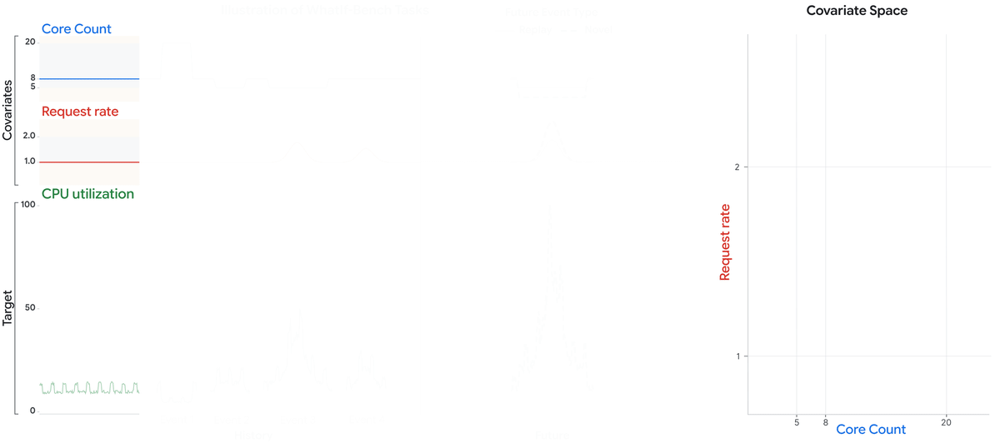

# WhatIf-Bench: Benchmarking Intervention-Aware Time Series Forecasting

[](http://ashok-arjun.github.io/papers/whatif-bench.pdf)


[](https://huggingface.co/spaces/arjunashok/WhatIf-Bench)

Recent time series foundation models can consume covariates in-context. This enables
*scenario analysis*: predicting how the target would evolve under different futures.

Whether they can do this reliably is an open question.

We built **WhatIf-Bench**, a semi-synthetic benchmark where each task presents a history of
events intervening on covariates, then asks to forecast a future event that either:

- **replays** seen values (Replay), or
- **sets them to unseen ones** (Novel).

Varying the number of covariates, historical events, and event length yields **37,665 tasks**.

<p align="center">
  
</p>

<p align="center">
  <em>Each WhatIf-Bench task shows a history of events that set the covariates, and asks a model
  to forecast the target under a future event that either repeats seen covariate values (Replay)
  or goes beyond them (Novel).</em>
</p>

We find that:

- Every model forecasts well on Replay futures (48 to 85% skill), but drops sharply on Novel futures (−7 to +50%).
- On Novel futures, skill falls steadily as events set more covariates at once, for every model.
- More past events in the history raise skill on Novel futures for most models, but gaps between
  models remain.

More results in the [paper](http://ashok-arjun.github.io/papers/whatif-bench.pdf), and every
method's results on the [leaderboard](https://huggingface.co/spaces/arjunashok/WhatIf-Bench).

## Coming soon

- **Evaluation code** — this repository: run any forecasting method over the benchmark and score it.
- **Dataset** — the 37,665 tasks, on HuggingFace.

## Citation

```bibtex
@article{ashok2026whatif,
  title={WhatIf-Bench: Benchmarking Intervention-Aware Time Series Forecasting},
  author={Ashok, Arjun and Parmar, Mihir and Goyal, Palash and Mishra, Bhavana Dalvi and Li, Chun-Liang and Rish, Irina and Drouin, Alexandre and Yoon, Jinsung and Pfister, Tomas},
  journal={arXiv preprint arXiv:2610.26582},
  year={2026}
}
```
